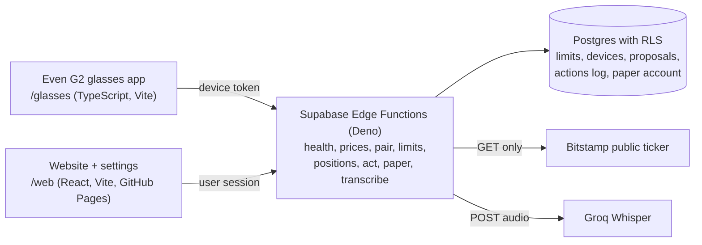

# Haltline

**A risk guard for one trading session, shown on Even G2 glasses.** One giant number tells you how much you can still lose today before your own daily loss limit, with a gauge that fills as you get close. When you reach the limit, one confirmed gesture cuts your positions.

- **Track:** Track 3, Exchanges & Stocks, "Heads Up: Even Realities Hackathon" (DoraHacks).
- **Live site:** https://ace-coderr.github.io/haltline/
- **Demo video:** https://youtu.be/FE8zsHU2s8o (shows the official Even Hub simulator and a paper account; not tried on physical glasses).
- **Who it is for:** active traders (crypto and equities) who set a daily loss limit and keep breaking it, because the moment they most need to look at a phone is the moment they least want to.
- **What it is not:** a stop-loss tool, a ticker or a portfolio tracker. It does one job: limit awareness and a last-gesture action.

## Verification status (read this first)

**Tested in the official Even Hub simulator. Not yet verified on physical glasses.** I do not have a pair of G2 glasses.

Hardware-unverified:

- **Swipe direction mapping.** The SDK does not document how `SCROLL_TOP_EVENT` and `SCROLL_BOTTOM_EVENT` map to swipe up and swipe down. The app ignores direction: any swipe advances to the next option, and a swipe on a confirm screen only cancels. A wrong guess cannot select or confirm anything.
- **BLE timing** of image and text updates, and how the pulse and gauge animation look on real hardware.
- **Font rendering and text widths** (the simulator's fonts differ from the hardware's).
- **Microphone PCM format** and the permission flow on real glasses.

## Paper account, priced from real public data

**The account is simulated paper trading.** It lives in this project's own Postgres database and is priced from real public market data (Bitstamp's public ticker, no API key). No real funds are held, no order ever reaches a real exchange, and nothing here is financial advice.

**Why paper:** exchange testnet sign-ups were not available in my region, so instead of faking an integration I built a paper exchange behind a small adapter interface (`supabase/functions/_shared/exchange.ts`).

**How a real testnet adapter would plug in:** implement `ExchangeAdapter` (`health`, `getPositions`, `getRealizedSince`, `getInstrument`, `placeReduceOnlyMarket`) for a testnet's API and return it from `runtime.ts` instead of the paper adapter. The limit maths, risk states, propose/confirm flow, cooldown, kill switch, glasses app and website sit above that interface and would not change. The outbound allowlist (`guard.ts`) would then need a deliberate edit to admit the testnet host, which is the point of having one.

The paper model, stated plainly: one account per person starting at 10,000 USD; net long or short positions; buys fill at the live ask and sells at the live bid, each plus 1 basis point of slippage; a 0.05% taker fee on every fill, counted as realised loss against your limit; positions marked at the bid/ask mid; total exposure capped at 5x equity; no liquidation engine; prices older than 15 seconds are never used.

## Pre-existing work

The official Even Hub minimal template was first downloaded on 19 Nov 2026 to test the development environment (a tap-counter test, no Haltline code, not part of this repo). The /glasses scaffold in this repo was downloaded fresh from that template on 23 Nov 2026. All Haltline code was written from 23 Nov 2026.

## What it does

| State | What the glasses show |
|---|---|
| **Calm** | `$437` and "left to lose today", with a short gauge. |
| **Closing in** (about 80% used) | `$11`, "left to lose today · CLOSE", with a long gauge. |
| **Tripped** | `LIMIT REACHED`, the menu `■ CUT HALF?  □ cut all  □ dismiss`, "swipe: change · press: confirm", and a pulsing gauge. |

Also handled, honestly: not paired (a 6-digit code), loading, offline (live numbers are replaced, never shown stale), prices unavailable, no limit set, no open positions, cooldown, writes switched off, and voice listening or unavailable.

Screens are real captures from the official simulator, committed in [`web/public`](web/public) and shown on the website.

**Controls.** Swipe: next choice (on an idle screen: start listening; on a confirm: cancel). Press: open the menu, select, confirm. Double press: exits the app; Haltline never uses it as an action.

**The action flow.** Choosing cut half or cut all proposes reduce-only orders and shows exactly what will happen (for example `BUY 1.500 ETHUSD · reduces short`). You confirm within 20 seconds. A press in the first moments is ignored as a stray press, a swipe cancels, and after an executed cut there is a 60 second cooldown.

**Voice (a bonus; the core works without it).** Swipe on an idle screen and say "set limit five hundred". The recording goes through the `transcribe` function (Groq Whisper, free tier) and is parsed; nothing is saved until you press to confirm. If voice is down or rate limited, the screen says so and a swipe-only stepper takes over.

## Architecture



- **`/glasses`**: the Even Hub app. Talks only to our backend. A pure state machine (`model.ts`) drives what is shown; `render.ts` sends only the containers that changed; the giant number is drawn as two side-by-side images.
- **`/web`**: the website and the settings: pair a device, set the limit, kill switch, open and close paper positions, live positions, actions log, docs with live backend status.
- **`/supabase`**: 8 Edge Functions plus migrations. All logic is in `functions/_shared`, written with injected dependencies so it is tested without a network.
- **`.github/workflows`**: site deploy to GitHub Pages, backend deploy, glasses `.ehpk` build, and a keep-alive ping.

## Safety model

Summarised here; the website's [Safety page](https://ace-coderr.github.io/haltline/#/safety) has the same list in plain language.

- **Paper only, enforced in code.** Every outbound request must match an exact allowlist: the public Bitstamp ticker (GET) and the speech endpoint (POST). A test scans the backend source and fails if any file names a real exchange's trading or payout surface, contains an unlisted host, or makes network calls outside the two approved modules.
- **Reduce-only cuts**, applied in one database transaction. A cut can close or shrink a position; it cannot open, grow or flip one.
- **Confirm, stray-press guard, cooldown.** Proposals are single-use and expire in 20 seconds. Confirm consumes the proposal exactly once, so a double press cannot send two orders. The 60 second cooldown is claimed atomically in the database; I fired six parallel confirms against production and exactly one executed.
- **Kill switch** on the website refuses every cut. The glasses cannot switch it back on.
- **The limit cannot be raised in a panic.** From the glasses, raising it is refused while you are close to the limit or past it, or when the state is unknown.
- **Fails closed.** Stale or implausible prices (older than 15 seconds, a crossed or very wide book, a 25% jump) are never used. Offline or priceless, the glasses replace the number and block actions. A confirm that gets no answer is never retried automatically.
- **No secrets on devices.** No exchange keys exist. The only server secret is the speech-service key. The glasses hold a revocable pairing token (only its hash is stored).
- **Row-level security.** You can read only your own rows; every write goes through the server. Wrong pairing codes are limited per person, globally, and per network address.
- **An actions log** records executions, failures, refusals (including refusals at the propose step), limit changes and kill-switch changes.

## Setup and run

Needs Node 24 (22 or newer works) and npm. Everything below uses free tiers. I ran each of these commands while building this; I did not create a second Supabase project from scratch to re-test the whole sequence.

```bash
git clone https://github.com/ace-coderr/haltline.git && cd haltline
cp .env.example web/.env && cp .env.example glasses/.env   # fill VITE_SUPABASE_URL and VITE_SUPABASE_ANON_KEY
```

**1. Backend (Supabase, free plan).** Create a project (an EU region is a good default). In Authentication, switch on "Allow anonymous sign-ins". Then, from `supabase/`:

```bash
npm ci
npx supabase login
npx supabase link --project-ref <your-ref>
npx supabase db push                                     # applies the migrations
npx supabase secrets set GROQ_API_KEY=<key>              # optional: voice only
npx supabase functions deploy --remote=<your-ref> --use-api --no-verify-jwt --yes
node scripts/live-check.ts                               # live end-to-end check, creates a test user
```

**2. Website.** `cd web && npm ci && npm run dev` (add `-- --port 5174` if the glasses dev server is running). `npm run build` produces the Pages build.

**3. Glasses app and simulator.** `cd glasses && npm ci && npm run dev`, then in a second terminal `npm run simulate`. The app shows a pairing code; enter it on the site's Pair page. Restart the simulator after every edit (hot reload does not update it). `npm run pack` builds the `.ehpk`.

**4. Tests and checks.**

```bash
cd supabase && npm test && npx tsc --noEmit && npx deno check functions/*/index.ts
cd glasses  && npm test && npx tsc --noEmit
cd web      && npm test && npx tsc -b
```

**5. Automatic deploys (GitHub Actions).** Set repository variables `VITE_SUPABASE_URL` and `VITE_SUPABASE_ANON_KEY` (public values) and the secret `SUPABASE_ACCESS_TOKEN`, then set Pages to the GitHub Actions source. Pushes to `web/` publish the site; pushes to `supabase/functions` test and deploy the functions. Migrations are never applied automatically.

## Testing and audit

- **Unit and integration tests:** 234 across the three packages (supabase 176, glasses 53, web 5). The database tests run the real SQL migrations in an in-memory Postgres (pglite). The paper adapter is tested against the real SQL.
- **Live checks against the deployed backend:** `supabase/scripts/live-check.ts` (the happy path, 31 checks) and `supabase/scripts/audit-live.ts` (a hostile suite). See [AUDIT.md](AUDIT.md) for what was found and fixed.
- **Accessibility:** axe-core reports no violations on all routes; layouts checked at 320 px.

## Honest limitations

- Simulator-tested only; see the verification section above.
- Paper fills do not model order book depth, partial fills, funding or liquidation. Real trading would differ.
- The anonymous account lives in one browser; clearing site data loses it. There is no email or password recovery yet.
- Free tiers: speech transcription is limited (about 20 requests per minute, no uptime guarantee) and an idle free Supabase project can pause (a scheduled ping keeps the demo awake; GitHub disables scheduled workflows after 60 days of repository inactivity).
- Prices come from a single public source and five markets.
- Rate limits on the functions are per server instance, not global. Anonymous sign-in abuse limits rely on Supabase's defaults and were not load-tested.
- The kill switch stops cuts; it does not block changing the limit (by design: the limit is a setting, not an order).

Requests for the Even Hub SDK and platform, based on gaps hit while building this, are in [FEATURE_REQUESTS.md](FEATURE_REQUESTS.md).

## License

[MIT](LICENSE), copyright Haltline contributors.
